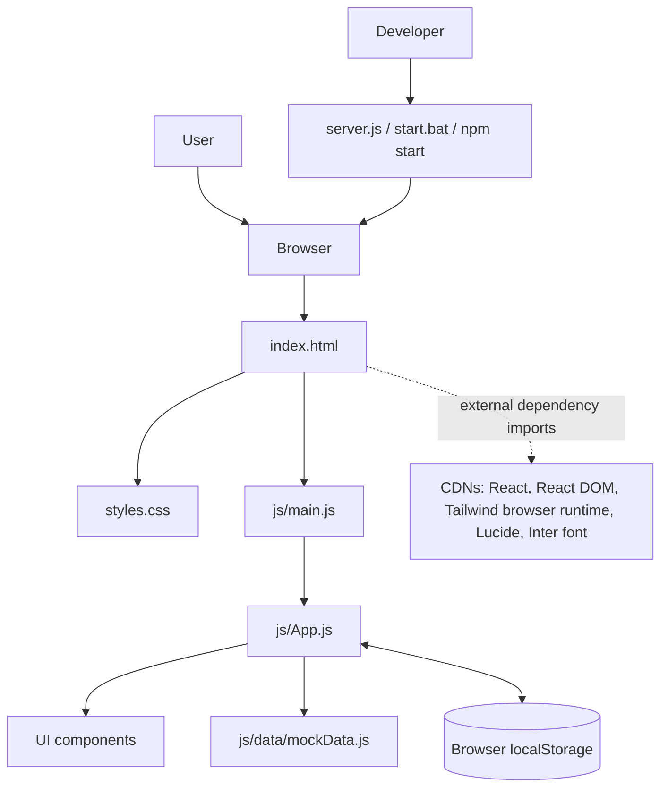
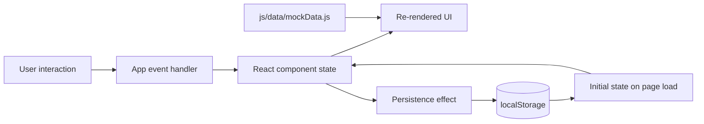
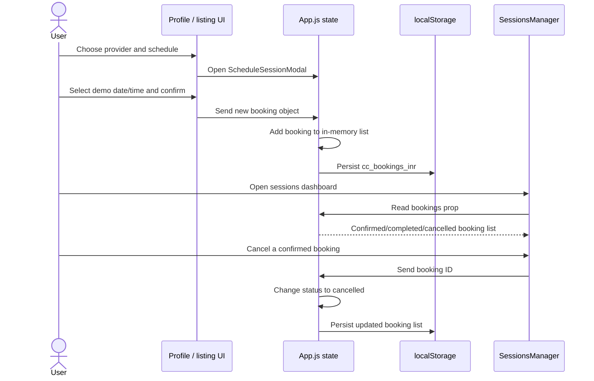

# Technical Design Document — Comforting Corner Prototype

**Document status:** Describes the current static front-end export.  
**System type:** Browser-rendered demonstration prototype.  
**Last updated:** 2026-10-27.

## 1. Purpose and scope

Comforting Corner demonstrates a user journey for discovering peer-support Buddies or therapists, viewing a profile, scheduling a sample session, managing appointments, saving profiles, and accessing support-resource information.

This document describes the implementation currently in this repository. It does not describe a production clinical platform or imply that the displayed provider credentials, appointments, messages, or calls are real.

### In scope

- Static HTML entry page and browser-loaded UI modules.
- React-based component rendering with Tailwind's browser runtime and Lucide icons.
- Local demo data and browser-local persistence.
- Local Node.js server used for development preview.
- Static hosting such as GitHub Pages.

### Out of scope / not implemented

- Server API, application database, durable cross-device storage, and real account authentication.
- Real-time chat, AI inference, moderation pipeline, WebRTC calling, or appointment reminders.
- Payment processing, provider identity/license verification, medical records, or clinical case management.
- Server-side audit trails, monitoring, rate limiting, and production secret management.

## 2. High-level architecture

### Runtime path

1. The browser requests `index.html` from the local static server or static host.
2. `index.html` loads the base stylesheet and Tailwind browser runtime, declares an import map for React/React DOM/Lucide, then imports `js/main.js`.
3. `js/main.js` mounts the React application into the `#root` element.
4. `js/App.js` owns primary view selection, active support mode, theme/language, saved provider IDs, session state, bookings, and open modal/drawer state.
5. Feature components render the relevant browsing, profile, scheduling, chat, sessions, safety-resource, and saved-profile UI.
6. The app persists selected values to `localStorage`; provider and support-resource sample content is imported from `js/data/mockData.js`.

There is no application server API or database in this architecture. `server.js` only serves static files and does not run the business workflows.

## 3. Main components

| Component/module | Responsibility |
|---|---|
| `index.html` | Page metadata, CSS links, CDN runtime, browser import map, root element. |
| `styles.css` | Base styles and theme-related CSS variables. Most utility classes are interpreted by the Tailwind browser runtime. |
| `js/main.js` | React root creation and application mounting. |
| `js/App.js` | Top-level state, persistence effects, navigation, modal coordination, and handler wiring. |
| `LandingPage.js` | Landing page and initial support-mode entry points. |
| `Header.js` | Navigation, search, language/theme controls, and access to saved items and sessions. |
| `BuddySection.js` / `TherapistSection.js` | Provider listing/search surfaces. |
| `BuddyProfileModal.js` / `TherapistProfileModal.js` | Provider details and actions. |
| `ScheduleSessionModal.js` | Demonstration scheduling workflow. |
| `SessionsManager.js` | Displays upcoming/confirmed, completed, and cancelled sample bookings; connects to the simulated video screen. |
| `BuddyChatModal.js` | Demonstration peer conversation using local simulated response content. |
| `VideoCallScreen.js` | UI simulation of a video session; not a real call implementation. |
| `UrgentLifelineModal.js` | Displays support resource content and outbound/call links from the local sample data. |
| `AuthOnboardingModal.js` | Demonstration onboarding flow, not server-backed identity verification. |
| `SavedDrawer.js` | Displays saved provider profiles. |
| `CcPointsModal.js` | Demonstrates the CC Points concept. |
| `js/data/mockData.js` | Sample providers, concerns/topics, price tiers, helpline entries, intake questions, and simulated Buddy responses. |
| `server.js` | Minimal Node HTTP static server with MIME handling and a configurable port. |

## 4. Application state and persistence

Current `localStorage` keys in `js/App.js`:

| Key | Shape / purpose | Default behavior |
|---|---|---|
| `cc_theme` | String theme value. | Defaults to `light`. |
| `cc_language` | `en` or `hi`. | Defaults to `en`. |
| `cc_session` | JSON object representing demo login state and user. | Defaults to `{ "isLoggedIn": false }`. |
| `cc_saved_ids` | JSON array of provider IDs. | Falls back to a small sample of saved IDs if stored JSON is invalid; initial value also seeds demo saved profiles. |
| `cc_bookings_inr` | JSON array of booking objects. | Seeds one sample appointment if no value exists; invalid stored JSON falls back to an empty list. |

The UI is authoritative only within the current browser profile. Storage can be edited by the user and does not synchronize across browsers or devices. Avoid storing real health information here.

## 5. Booking flow

The above flow is client-side only. It does not reserve a real provider time slot, notify a provider, charge money, or create a server-side booking record.

## 6. Data design

Provider listings and supporting content are currently JavaScript constants. Representative JSON fixtures for future integration and manual QA are stored under `sample-data/`.

### Peer Buddy profile — representative fields

- `id`, `name`, `avatar`
- education/institution and training/verification display flags
- `topics`, `languages`, `approach`, `bio`
- `price`, `rating`, `reviewCount`, availability and review content

### Therapist profile — representative fields

- `id`, `name`, `title`, `avatar`
- `credentials`, `licenseNumber`, `experienceYears`
- `specializations`, `modalities`, `ageGroups`, `languages`, session mode/duration
- `price`, `rating`, `reviewCount`, available slots, and review content

### Booking — representative fields

- `id`, `providerId`, `providerName`, `providerTitle`, `providerAvatar`
- `serviceType`, `date`, `time`, `timeZone`, `mode`, `price`, `duration`
- `status`, `clientNotes`, `createdAt`

For the app's current sessions view, booking statuses include `confirmed`, `completed`, and `cancelled`.

## 7. Local server and deployment

`server.js` uses Node's built-in `http`, `fs`, and `path` modules. It serves files from the project root, maps common file extensions to content types, returns 404 for missing files, and includes a basic path containment check. The default port is `8000`; the optional `PORT` environment variable overrides it.

For static hosting, GitHub Pages can serve the repository's root `index.html` and relative modules. External CDNs and remote assets must remain reachable. No environment variable is required at build time because this export has no build step.

## 8. Environment configuration

| Variable | Used by | Default | Notes |
|---|---|---|---|
| `PORT` | `server.js` | `8000` | Optional local preview port. |

No `GEMINI_API_KEY`, `APP_URL`, or other external service credential is read by this static export. Although those variables existed in the original scaffold example, this code does not call Gemini or a backend API. Do not create or publish real credentials for the current prototype.

## 9. Security, privacy, and clinical-safety considerations

1. **No real authentication:** the onboarding screen is a UI flow. It must not be treated as account verification.
2. **Local-only data:** `localStorage` is editable and not a secure clinical record store.
3. **Synthetic content:** provider details, ratings, reviews, licenses, prices, schedules, and bookings are demo data and require verification before any real service launch.
4. **No real chat/video:** conversation replies are simulated; the call screen is a presentation mockup. No WebRTC signaling or media transport is implemented here.
5. **No payments:** price display is illustrative; no payment gateway is integrated.
6. **Crisis resources:** resource details should be independently checked before public/production use. The prototype is not an emergency service and should not imply continuous monitoring.
7. **CDN dependency:** some runtime code and visual assets are fetched externally. A CDN outage or network policy may prevent parts of the page from loading.
8. **Third-party assets:** remote image/font/library providers retain their own terms and licenses.

## 10. Known constraints and recommended next steps

- Add a backend API and database before real booking or account features are offered.
- Implement authentication, authorization, input validation, rate limiting, logging, and secure session management server-side.
- Replace simulated scheduling with server-validated availability and conflict prevention.
- Integrate a real payment provider only after legal/security review; never store card details in the app.
- Build secure chat/video with an appropriate transport and clear consent/privacy controls; do not label simulated chat as AI or clinical care.
- Add automated tests and CI, including accessibility checks and responsive-browser testing.
- Review clinical safety, data retention, consent, privacy, and applicable legal requirements before handling sensitive data.

## 11. Verification checklist

- [ ] Landing page mounts and styles load.
- [ ] Buddy and therapist listings render sample content.
- [ ] Profile, scheduling, saved items, sessions, support-resource, and CC Points overlays open and close.
- [ ] Theme/language preferences survive a reload.
- [ ] Saved IDs and bookings persist per browser as intended.
- [ ] No private keys or real health data are present in the public repository.
- [ ] README and manual test scenarios match the published build.
